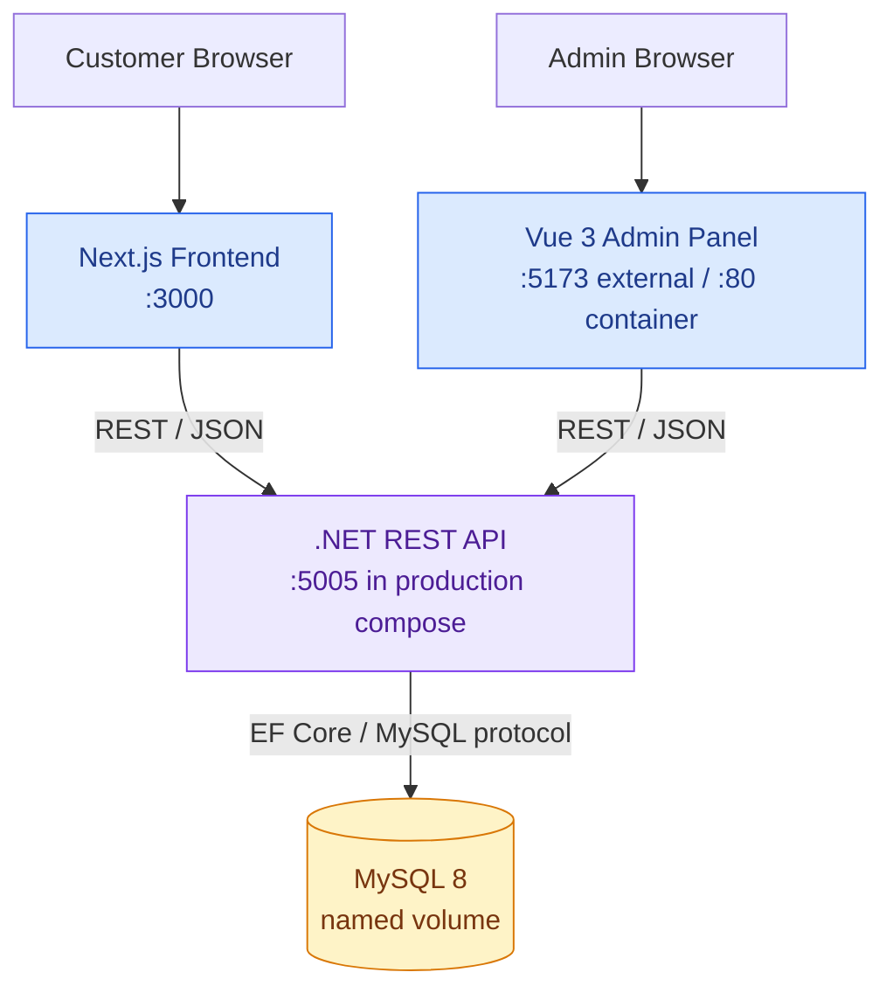
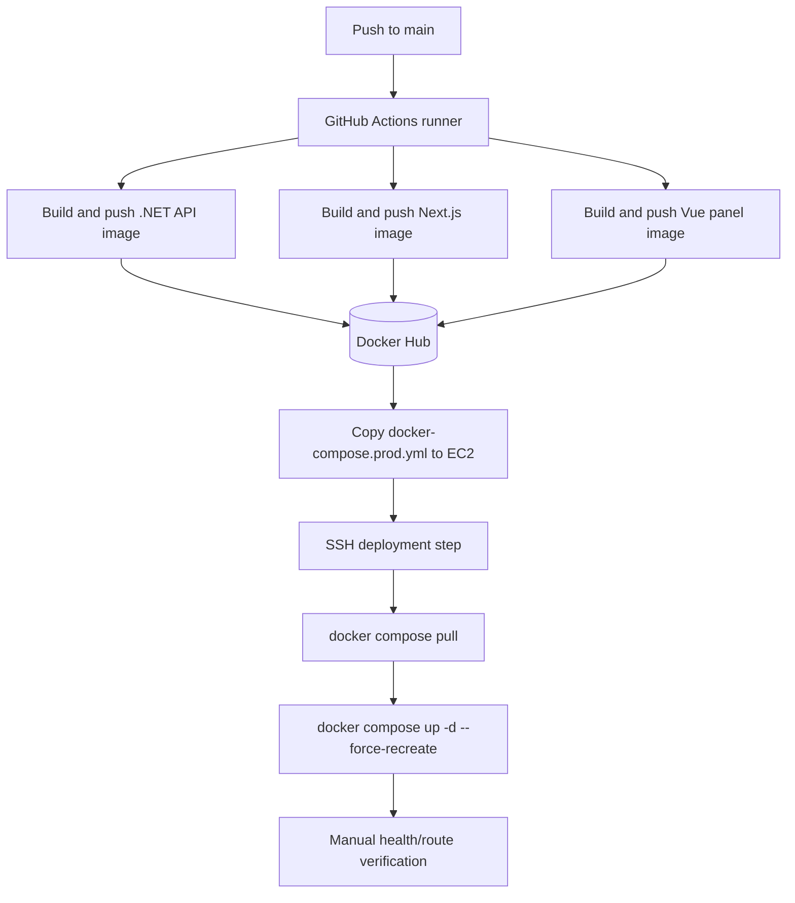

<div align="center">


  

</div>

---

# Three-Tier Application — Docker and Automated EC2 Delivery

A full-stack monorepo with a .NET REST API, a Next.js customer-facing web app, a Vue 3 admin panel, and MySQL. Docker Compose provides a repeatable local stack; GitHub Actions builds/pushes three images and deploys them to an EC2 host over SSH.

     

[**Source code**](https://github.com/AhmedRaza92110/docker-3tier-application-project) · [Deployment workflow](.github/workflows/deploy.yml) · [Architecture notes](docs/overview.md) · [Deployment guide](docs/deployment.md)

## 🏛️ Application architecture



## 🔁 CI/CD pipeline



The workflow builds three images with the `latest` tag, then copies the production Compose file to EC2, pulls the images and recreates containers. It does **not currently include automated tests, image vulnerability scanning, immutable release tags, or an automated post-deploy smoke-test/rollback stage**.

## 🧩 Stack and infrastructure decisions

| Layer | Technology | Why |
|---|---|---|
| Customer UI | Next.js | Component-driven web experience |
| Admin UI | Vue 3 + Vite | Separate admin experience and independent build |
| API | ASP.NET Core REST API | Typed HTTP boundary for business operations |
| Database | MySQL 8 | Relational storage for products, users, orders and categories |
| Local orchestration | Docker Compose | One command starts the database and application tiers |
| Image distribution | Docker Hub | Separates image build from target-host runtime |
| Automation | GitHub Actions | Repeatable build, publish and deployment workflow |
| Runtime host | AWS EC2 | Simple, understandable target for a first automated deployment |

## ▶️ Run locally

Prerequisites: Docker Desktop with Compose.

```bash
docker compose up --build
```

Open:
- Next.js frontend: `http://localhost:3000`
- Vue admin panel: `http://localhost:5173`
- .NET Swagger/API: `http://localhost:5000/swagger`

Stop containers with `docker compose down`. Use `docker compose down -v` only if you intentionally want to delete the local MySQL volume and its data.

> **Important:** The local Compose file contains example development credentials and publishes the database port. Do not reuse those values in a public or production environment.

## 🔐 GitHub Actions secrets and EC2 setup

The workflow expects these repository Actions secrets:
- `DOCKER_PASSWORD` — Docker Hub access token.
- `EC2_HOST` — EC2 public DNS/IP.
- `EC2_USERNAME` — SSH user.
- `EC2_SSH_KEY` — private SSH key content.

The EC2 host needs Docker Engine and the Docker Compose plugin installed, outbound access to Docker Hub, and permission to run containers. Restrict SSH ingress to trusted IPs and never commit private keys or credentials.

## 💡 Architecture trade-offs

- **Single EC2 host:** inexpensive and easy to understand for a portfolio demo, but it is a single point of failure and does not provide multi-AZ high availability.
- **Compose on the host:** appropriate for a small deployment, but it is not a cluster scheduler.
- **Separate UI containers:** lets each UI be built/released independently, but requires a clear API URL strategy.
- **MySQL named volume:** retains data across container recreation on that host, but is not a backup or disaster-recovery strategy.
- **Image registry:** makes deployment pull the same packaged artifacts that CI produced; immutable SHA tags would improve traceability over `latest`.

## 🛡️ Production-hardening roadmap

- [ ] Replace default DB passwords and remove production fallback credentials.
- [ ] Use GitHub OIDC or scoped short-lived cloud credentials where practical; restrict EC2 SSH access.
- [ ] Build and deploy immutable commit-SHA tags, not only `latest`.
- [ ] Add .NET/frontend/panel tests, linting and Trivy image scans as required gates.
- [ ] Add health checks and post-deploy smoke tests; keep the previous known-good release for rollback.
- [ ] Put a TLS reverse proxy or ALB in front of the services; keep the database private.
- [ ] Move persistent production data to a managed database with backups and restore testing.
- [ ] Add logs, metrics, alerting and a documented teardown/recovery runbook.

## 📁 Repository layout

```text
apis/                    ASP.NET Core API and Dockerfile
frontend/                Next.js customer UI and Dockerfile
panel/                   Vue 3 admin UI and Dockerfile
database/init.sql        MySQL initialization
docker-compose.yml       Local development stack
docker-compose.prod.yml  EC2 image-based deployment stack
.github/workflows/       GitHub Actions build/push/deploy workflow
docs/                    Architecture and component guides
```

<div align="center"><sub>End-to-end application delivery practice with explicit trade-offs and next steps.</sub></div>
